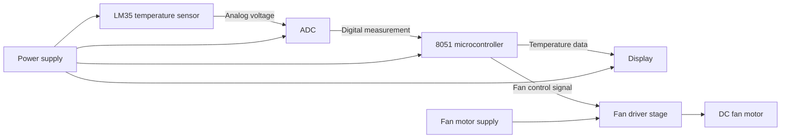
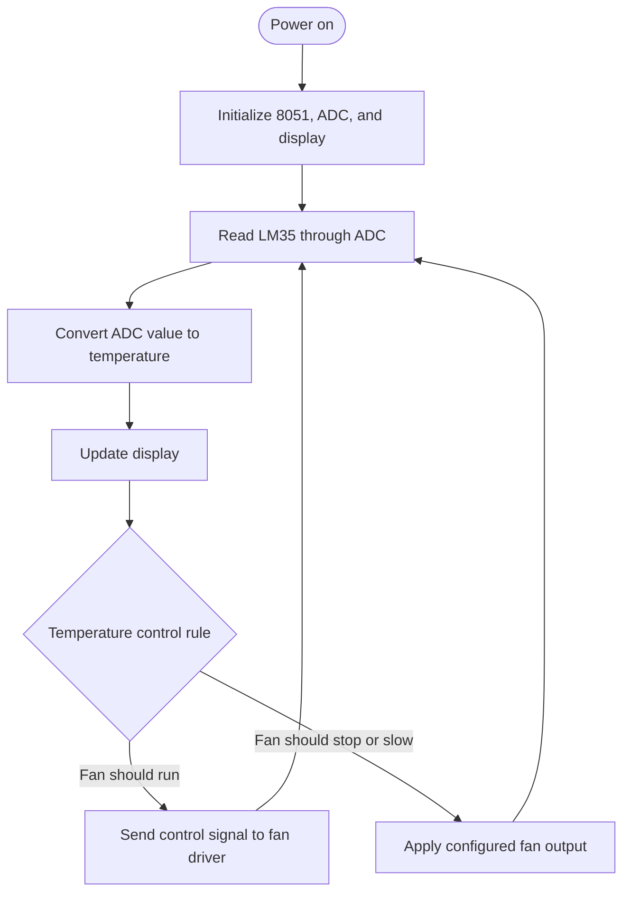

# Temperature-Controlled Fan Using 8051

A PCB-based temperature monitoring and fan control project built around an 8051 microcontroller. An LM35 senses the surrounding temperature, an ADC converts its analog output into digital data, and the 8051 uses that reading to update a display and control a DC fan.

> **Project-specific details to fill in:** Add your exact 8051 part number, ADC model, display type, fan driver components, temperature threshold or speed-control behavior, and the other features implemented on your PCB. These details were not provided, so this README avoids guessing them.

## Features

- Measures temperature using an LM35 sensor
- Converts the sensor's analog output using an ADC
- Displays the measured temperature
- Controls a DC fan in response to temperature
- Integrates the circuit on a custom PCB
- Includes additional PCB functions: **[Add the other implemented features here]**

## System Block Diagram



## How It Works

1. The LM35 produces an analog voltage that changes with temperature.
2. The ADC converts this voltage into a digital value the 8051 can read.
3. The 8051 converts the ADC reading into a temperature value.
4. The temperature is shown on the display.
5. The controller adjusts the fan output according to the project's programmed temperature-control method.

Specify whether your PCB switches the fan on/off at a set temperature or varies its speed. If it uses a threshold, document that value in the configuration section below.

## Control Flow



## Hardware Components

| Component | Purpose | Project-specific detail |
|---|---|---|
| 8051-family microcontroller | Reads the ADC, updates the display, and controls the fan | Add exact part number: **[e.g., your fitted 8051 variant]** |
| LM35 | Temperature sensing | — |
| ADC | Converts LM35 analog output to digital data | Add exact model: **[ADC model]** |
| Display | Shows the temperature and any other information | Add type: **[LCD / seven-segment / other]** |
| DC motor / fan | Provides airflow | Add motor rating: **[voltage/current if known]** |
| Fan driver stage | Allows the 8051 to control the motor load | Add the actual transistor/driver/relay part used |
| Custom PCB | Holds and connects the project circuit | — |
| Power supply | Powers the logic and fan sections | Add voltage/current ratings and how the rails are generated |

## Circuit Connections

The following is a functional connection overview. Use your PCB schematic or board labels for exact pin numbers; those depend on the 8051 variant, ADC, display, and PCB layout.

| Signal path | Connection |
|---|---|
| Temperature sensing | LM35 output to an ADC analog input |
| ADC data | ADC digital outputs to the 8051 input port |
| ADC control | ADC conversion/read control signals to 8051 pins |
| Display | Display data and control pins connected to 8051 pins |
| Fan control | 8051 output pin to the PCB's fan driver stage |
| Fan motor | DC fan connected to the driver output and its rated supply |
| Ground | Logic, ADC, sensor, and motor-driver grounds connected as required by the PCB design |

## Temperature and Fan Settings

Fill in the values and control behavior used by your firmware.

| Setting | Value |
|---|---|
| Fan control method | **[On/off control or speed control]** |
| Fan-on temperature | **[Add value in °C, if applicable]** |
| Fan-off temperature / hysteresis | **[Add value in °C, if applicable]** |
| Speed levels or PWM range | **[Add details, if applicable]** |
| Display units and format | **[°C / °F and display type]** |

## PCB Features

List the other features implemented on your PCB here. For example, include only functions that are actually present, such as power regulation, status indicators, buttons, alarm output, or selectable settings.

- **Additional feature 1:** [Describe it]
- **Additional feature 2:** [Describe it]

## Firmware and Usage

1. Add the 8051 source code and any required project files to this repository.
2. Document the compiler or IDE and programmer used: **[Add tool names]**.
3. Program the 8051 with the project firmware.
4. Power the PCB using the specified supply.
5. Confirm that the display shows the temperature and that the fan responds as intended.

## Suggested Repository Contents

```text
.
├── README.md
├── firmware/       # 8051 source and project files
├── schematic/      # Circuit schematic, if available
├── pcb/            # PCB layout or design files, if shareable
└── images/          # PCB, assembled project, and demo photos
```

## Project Information

- **Project:** Temperature-Controlled Fan Using 8051
- **Controller:** 8051 family — **[Add exact part number]**
- **Sensor:** LM35
- **Conversion:** ADC — **[Add exact model]**
- **Output:** Display and DC fan
- **Build:** Custom PCB
